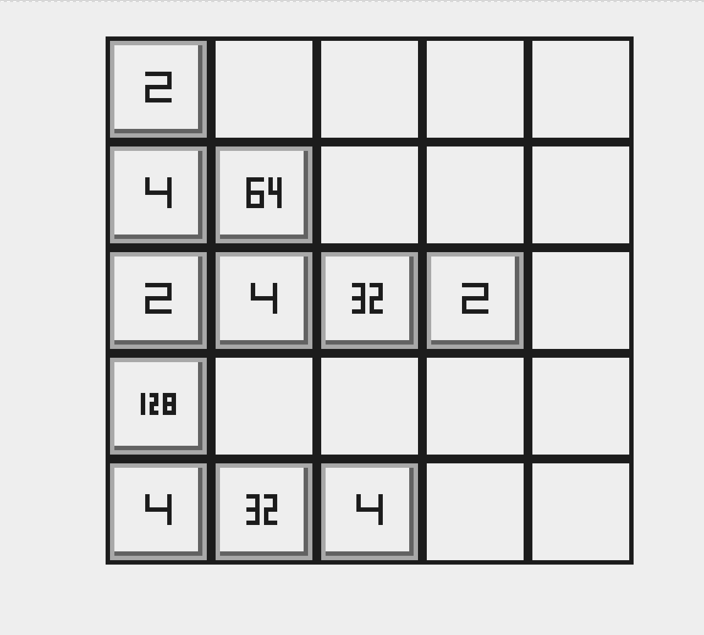
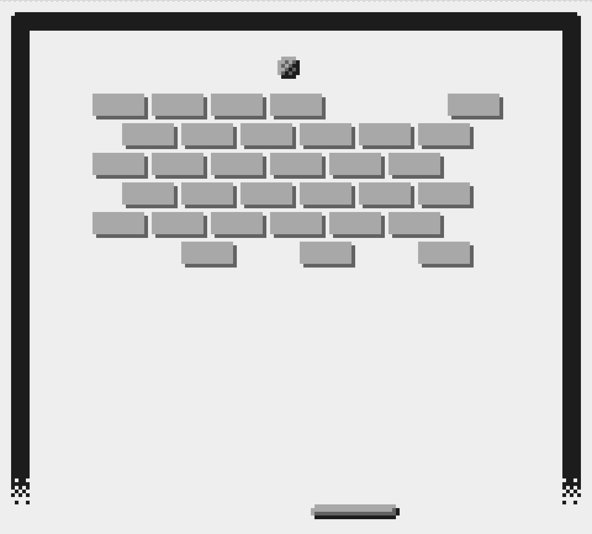
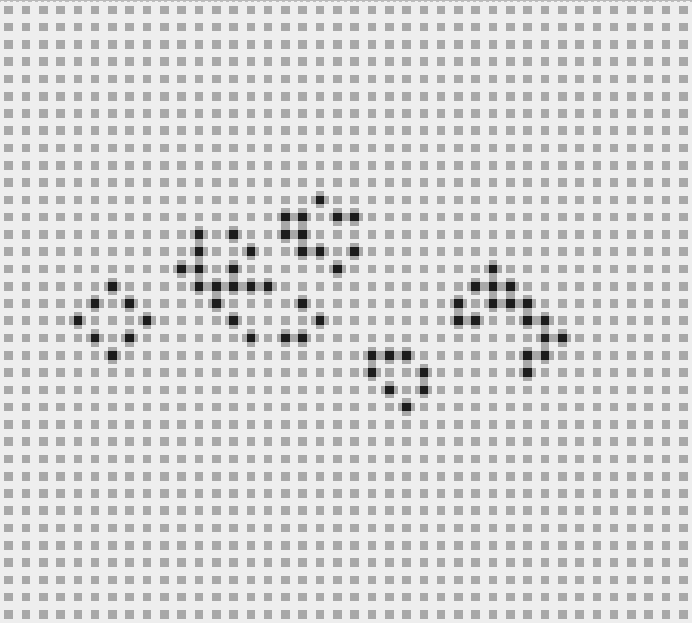
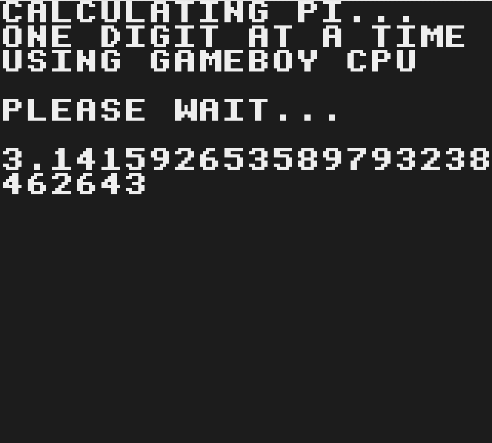
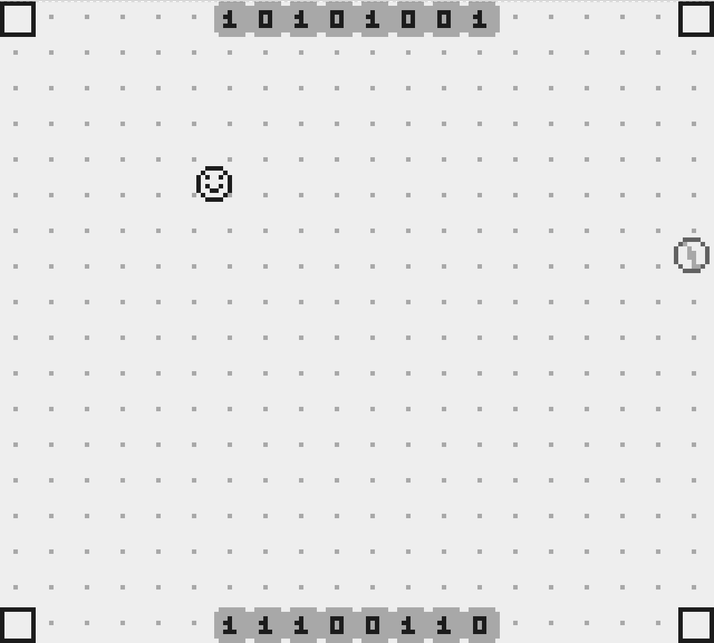
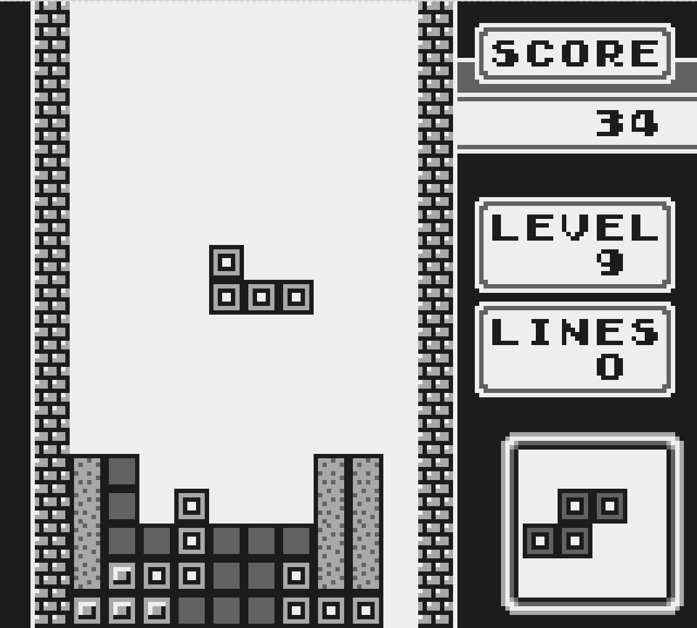
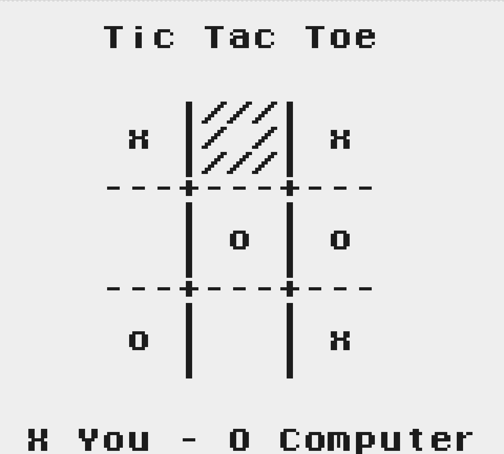
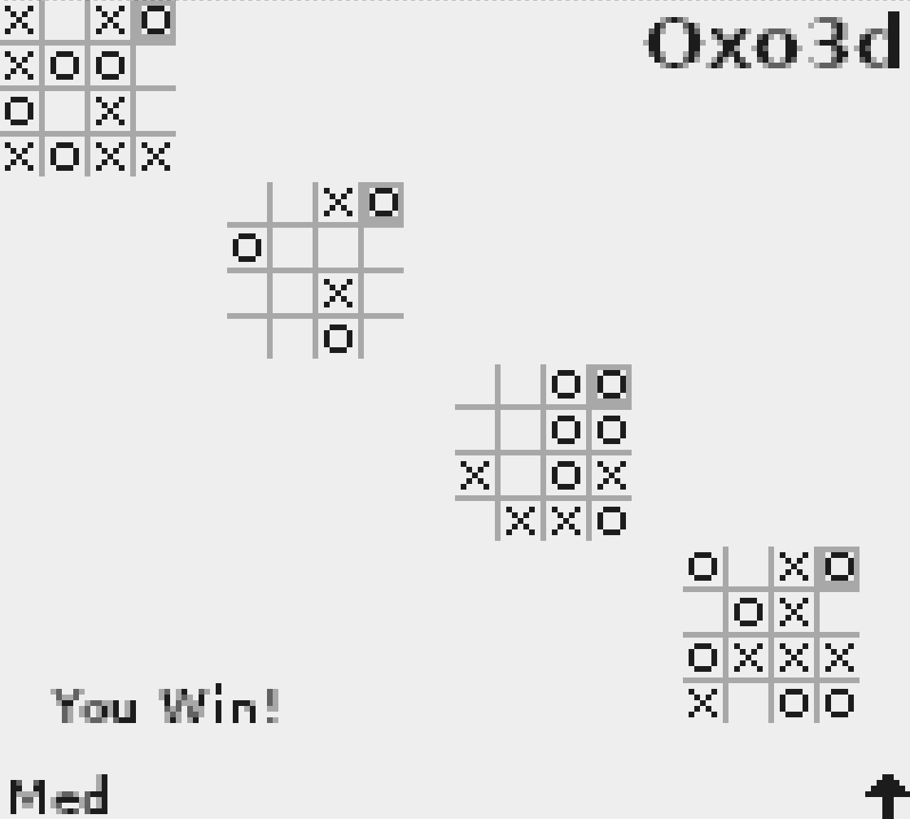
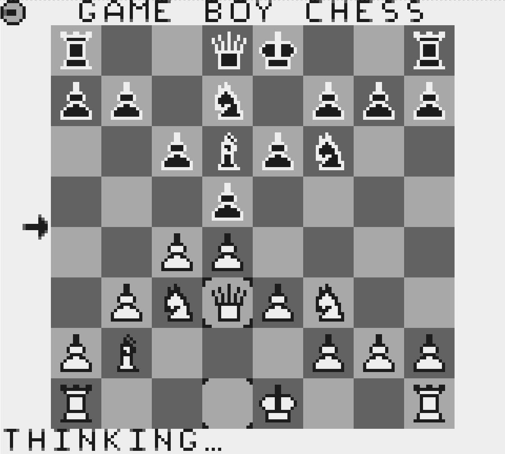

#  The "Tetris-Optimized" Terminal Game Boy Emulator

This is my third IOCCC 29 (2026) entry.

Look at [remarks.md](./remarks.md) for instructions.

Check the  source code out [prog.c](./prog.c). That should give you a bit hint as to what it does!

Here is what the output should look like:

        

Things to look at:
- [gb.c](./gb.c) for the source. I hesitate to say it is unobfuscated, but it is easier to read than `prog.c`!
- [crunch.py](./crunch.py) and [shape_code.py](./shape_code.py) to see how `prog.c` was generated.
- [test_rom](./test_rom/) for the source of the `Test.gb` ROM.
- [oxo3d](https://github.com/ncw/gameboy-oxo3d) for the source of the 3d tic-tac-toe ROM.
- [gbchess](https://github.com/ncw/gbchess) for the source of the chess ROM.
- [gbpi](https://github.com/ncw/gbpi) for the source of the pi generating ROM.

The rest of the repo is how it was made if you are interested - more info (scrappy) in [NOTES.md](./NOTES.md)

